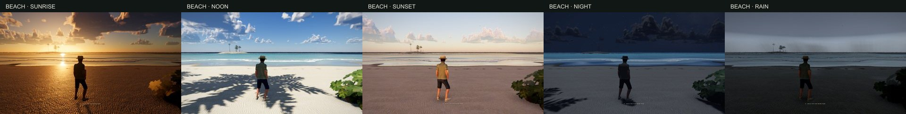
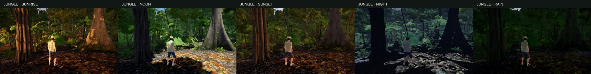
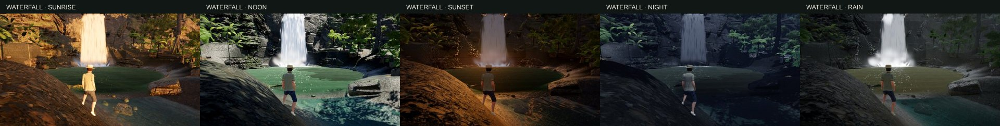
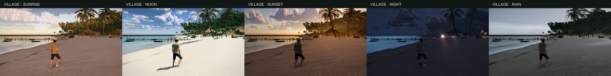
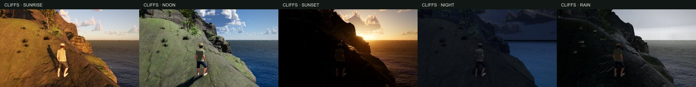
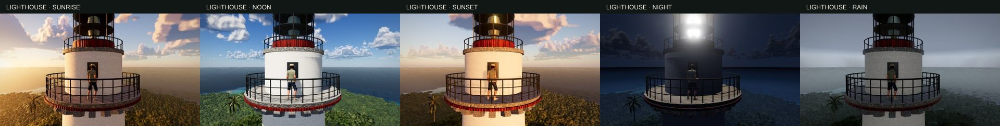

# Round 2 visual and gameplay critique

## Evidence

Reviewed all 30 production screenshots in `round-02/captures/` at 1920×1080, DPR 1, WebGPU/high, using the follow camera. The six contact strips below contain sunrise, noon, sunset, night, and rain in that order; the original full-size images remain in the `captures/` folder. The production build loaded without console errors or warnings. On the M2 MacBook Air, the app reported ready in 18.9 seconds.

The only connected display was the MacBook’s built-in panel. These captures therefore do not establish a second-screen review. A separate 12-second warm sample at 1920×1080/high averaged **18.25 fps** (p50 50 ms, p95 116.6 ms, p99 117.5 ms), against the requested 60 fps. A renderer readout near the beach showed 196 draw calls, 4,814,259 triangles, 399 geometries, and 194 textures. The triangle, geometry, and texture counts exceed the Three.js AAA skill’s advisory desktop starting points (750k, 300, and 60 respectively); the frame-time result confirms the practical impact. The adapter string was only `ANGLE`, so this run does not identify which M2 GPU core was selected.

A real keyboard check at the sunrise beach confirmed that the on-screen E prompt appears, E opens the page overlay, and Escape closes it. The paper stand itself is hidden behind the player at spawn. After reading the page, the runtime reported a Keeper sighting (`phase=watching`, `presenceCount=1`) and projected its center almost exactly to screen center (`x=-0.025, y=0.014`). The saved gameplay screenshot contains no second figure: the apparition is aligned behind the avatar and occluded by the player. The first encounter state fires; the intended visual encounter is not readable in this camera composition.

## Side-by-side capture and reference strips

Each local strip shows all five weather/time captures for that named location. The adjacent real photographs and official Ghost of Tsushima screenshot are comparison references only; they are not game assets. The photograph links lead to Unsplash pages that identify the photographer and license. Ubisoft’s official [Far Cry 6: Postcards from Yara](https://toronto.ubisoft.com/post-cards-from-yara/) and [world-building notes](https://toronto.ubisoft.com/gdc-2022-ubisoft-toronto-far-cry-6/) provide a second AAA tropical-world reference. The [official Ghost of Tsushima screenshot gallery](https://www.playstation.com/en-us/games/ghost-of-tsushima/pc/) provides the game screenshots. For coastline color and reef breakup, compare against [Hoodh Ahmed’s Dhigurah lagoon photo](https://unsplash.com/photos/an-aerial-view-of-a-tropical-beach-and-lagoon-Kmf8MZkk9GQ); for cliff-to-sea scale use [Harshil Gudka’s Ko Tao viewpoint photo](https://unsplash.com/photos/a-view-of-a-tropical-island-from-a-cliff-t_Mf9ArLCic).

| Saltwake: sunrise → rain | Real tropical reference | AAA open-world screenshot |
|---|---|---|
|  |  |  |
|  |  |  |
|  |  |  |
|  |  |  |
|  |  |  |
|  |  |  |

## Ranked viewer-visible gaps for Round 3

1. **M2 frame rate misses the 60 fps target by a wide margin.** At high quality the 12-second sample averaged 18.25 fps, with p95 at 116.6 ms. The 4.8M triangles, 399 geometries, and 194 textures leave obvious optimization targets. Measure low/medium and the actual default first; then lower or cull distant foliage/terrain work, shadow passes, water segments, and post-processing until the Mac can hold the target. Preserve a separate high preset for faster GPUs.
2. **The Keeper is hidden behind the player during the scripted first encounter.** The runtime state says it spawned and is on screen, but the captured view shows only the player. Offset the figure laterally from the player-camera line, give its silhouette a distinct readable pose/profile, and capture the first 10 seconds of the reveal at normal follow-camera height. The current reused traveler outfit and hat-like head shape do not read as a supernatural keeper at distance.
3. **The lighthouse still fails to reveal the island.** In all five gallery states, the cylindrical tower wall occupies the center of the frame and blocks the view; the horizon and ocean dominate the remaining aperture. At night the beacon remains a large clipped white patch at the top of frame, even though the earlier wide wedge is gone. Move the spawn/camera to the outward gallery rim and compose a visible island ridge-to-coast panorama; meter the lamp so its lens retains shape.
4. **The coast and waterfall still read as layered shader bands.** The crossed swells do not change the visible long parallel crests: the beach has a razor-straight horizon, a narrow teal boundary, broad cream/white sheets, and a jagged dark seam at the shore. The nearshore water has no clear reef-to-sand pattern comparable with the real lagoon photo. At night it remains a nearly uniform navy plane. At the waterfall the flow is still a broad uniform white curtain, while the opaque green pool uses repeated white squiggle highlights; the rock basin reads as stacked rectangular plates. Add depth/color transitions, broken foam and spray, irregular wavefronts, and distinct pool depth rather than increasing only wave count.
5. **Materials and foliage retain procedural repetition at close range.** Jungle views have a dense canopy but repeat the same umbrella-like leaf clusters, thin straight trunks, and leaf-litter pattern. Cliff shots show stacked, sharply bounded rock plates, with isolated grass tufts that do not bridge the seams. Village huts and docks have unvaried dark timber planes and straight, evenly spaced pilings; boats read as identical black cutouts. Ghost of Tsushima’s official forest/coast screenshots and Far Cry 6’s tropical references have more varied leaf silhouettes, foreground-to-background layering, and clear surface wear at equivalent camera scale.
6. **Weather and exposure still destroy detail in specific states.** Sunrise and sunset beach water and sky clip toward white around the sun while the player becomes a near-black silhouette. Noon beach sand clips to pale white and throws hard palm shadows. Cliff sunset/night hides most of the rock face in black. Rain scenes show a flat grey horizon band; the close sand, rocks, and dock boards do not show a convincing wet sheen or splash response. The raised village smoke is too small/faint to read in the rain village capture. Soften cloud silhouettes, retain highlight detail, lift dark environmental surfaces slightly, and make wetness visible at close range.
7. **The fishing village has no visible activity.** Across the five village images there is no person at the dock, boat movement, or clearly readable fishing task. The stronger smoke is visible only as a faint distance cue; it does not make the settlement feel occupied. Add a small set of animated, low-cost activity and weathered fishing details where the camera can see them: nets, line, gear, hull differences, and boat bobbing.
8. **The note prop is still visually missing at spawn.** The E prompt and note card are functional; the stand is underneath/behind the avatar because the player spawns on its coordinates. Move the stand a few steps into the natural forward view and confirm it does not collide with the player or disappear against the sunlit surf.

## Location-by-location notes

- **Beach:** Sunrise has a bright sun disk and reflection that bleach the horizon; dark avatar and beach micro-ripples dominate the frame. Noon washes the sand and repeats the same broad bands of water. Sunset preserves the same rigid shore geometry. Night water is a uniform blue-black strip. Rain creates a flat grey sea/sky divide without strong wet-sand response. The clue prompt is visible, but the clue stand is not. The first Keeper image has no visible apparition.
- **Jungle:** All five states retain the same repeated broad leaves and straight trunks. Noon exposes the player and a large root flare while the deeper forest remains dark; rain gives the ground a dark sheen but not varied wet leaves. Night has high contrast and silhouettes the large trunks. The player model still wears the same light shirt and broad hat in the jungle.
- **Waterfall:** All five states have one continuous white flow with no separated streams or visible spray volume. The pool stays opaque green with repeated thin white highlights; night only darkens the pool. Rock surfaces repeat rectangular slabs and hard seams at the waterline. Rain does not make the cascade or nearby rock materially wetter.
- **Village:** Daytime shots expose wide empty sand between the camera and huts. The dock pilings are evenly spaced, and boats do not visibly bob or vary enough in silhouette. Night silhouettes the huts and player; rain leaves the boards/sand almost the same material value as clear weather. The smoke does not read as a strong sign of life at this camera distance.
- **Cliffs:** Rock planes form sharp steps with small patches of grass. The sunset shot loses most of its near cliff face to black; the sunrise and rain shots leave a broad ocean/horizon gap with little depth layering. Night preserves little rock detail.
- **Lighthouse:** The new starting point still looks into the tower wall; this defeats the promised high-point island panorama in sunrise, noon, sunset, and rain. At night the bright lamp clips to a white rectangle/blob at the top center and the wall hides the island. The camera needs to sit outside the lantern-room silhouette, not only farther back.

## Visual scorecard

No numerical Round 1 baseline was saved. Current active-play evidence (0–3 scale, where 2 is premium stylized):

| Category | Current | Evidence |
|---|---:|---|
| Art direction | 1 | Sunrise palette and horror note text exist, but the first reveal is visually absent and other states lose detail. |
| Hero/player | 1 | The back-view traveler reads as a generic hiker in a light shirt and wide hat, not a horror-game survivor. |
| Threat/enemy | 1 | A sighting state runs, but the Keeper is occluded; the silhouette is not distinct from the traveler. |
| Interactable | 1 | E prompt and paper overlay work, but the physical stand is hidden at spawn. |
| World/environment | 1 | Dense trees exist, but the 30 views show repeated silhouettes and the lighthouse view is blocked. |
| Materials/textures | 1 | Water, rock, sand, timber and boats show broad uniform regions or repeated procedural patterns. |
| Lighting/render | 1 | Sunrise/noon clip highlights; sunset/night crush cliffs; the lighthouse lens still clips. |
| VFX/motion | 1 | Still captures show water/rain, but the Keeper reveal is static/occluded and weather lacks close-up response. |
| UI/HUD | 1 | The E prompt is small; the page overlay is readable and Escape closes it. |
| Performance evidence | 2 | Target-size captures and renderer counts exist, but the measured M2 result fails the target and no before/after optimization exists. |

**Average: 1.1 / 3.** Premium threshold is not met. A still capture cannot establish locomotion, water motion, foliage wind, rain clearing, or boat animation; those remain unverified. No second external display was available for the requested second-screen run.
