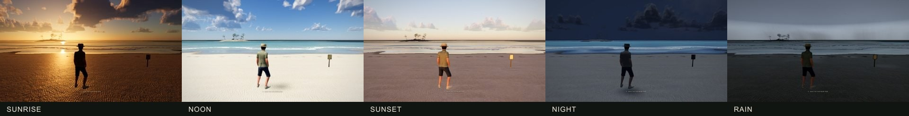
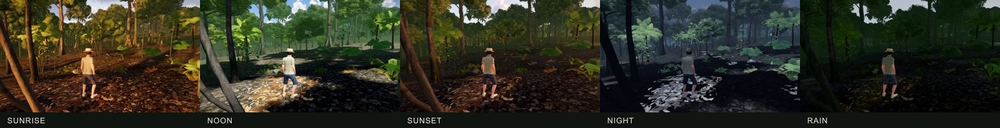
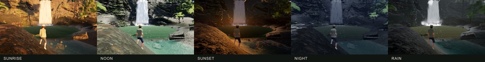
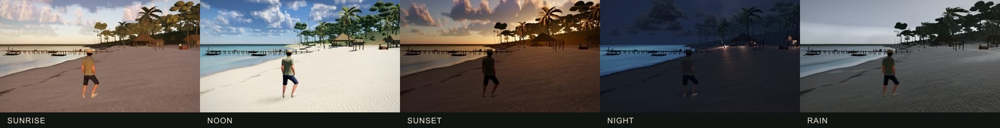
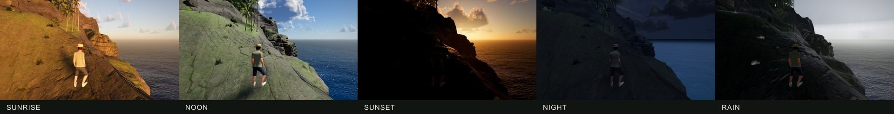
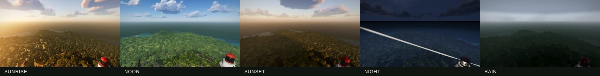

# Round 3 visual critique

## Capture and comparison method

Reviewed the six Round 3 contact boards and all 30 underlying captures (beach, jungle, waterfall, village, cliffs, lighthouse × sunrise, noon, sunset, night, rain). The contact boards below put the five states side by side; the full-size originals are in [`round-03/captures/`](round-03/captures/). Also reviewed `beach_first_keeper.jpg`, `beach_note_open.jpg`, and `captures/report.json`.

The capture rig reports Chrome/WebGPU on `ANGLE`, low preset, render scale **0.5**, 1920×1080 output, and a 7.52 s ready time. The viewport is marked **emulated** at `DISPLAY1`; only the laptop's built-in panel is connected. These captures do not establish native 1920×1080 rendering or use of a second physical display. The low-scale upsampling is visible as softened leaf edges, fine rock detail, character edges, and water/shore transitions.

Reference board sources are linked below. Unsplash pages label each selected photo as free under the Unsplash License; images are hotlinked for review and no reference files are copied into the repo. The AAA columns use publisher-hosted official screenshots linked from PlayStation's [Far Cry 6](https://www.playstation.com/de-de/games/far-cry-6/) and [Ghost of Tsushima PC screenshot gallery](https://www.playstation.com/en-us/games/ghost-of-tsushima/pc/). Those copyrighted screenshots are embedded from the publisher CDN for comparison only; no local copies were made. Ubisoft describes Yara as spanning jungle, beach, and city environments in its [Far Cry 6 world overview](https://toronto.ubisoft.com/games/far-cry-6/).

## Side-by-side evidence boards

Each local contact strip contains all five lighting/weather captures. Compare the specific foliage silhouettes, coast depth, cliff material breakup, and environmental scale against the real photo and the official open-world screenshot beside it.

| Location and game captures | Real tropical reference | AAA open-world screenshot reference |
|---|---|---|
| **Beach**  |  [Photo and Unsplash License](https://unsplash.com/photos/an-aerial-view-of-a-tropical-beach-and-lagoon-Kmf8MZkk9GQ) |  [PlayStation screenshot gallery](https://www.playstation.com/en-us/games/ghost-of-tsushima/pc/) |
| **Jungle**  |  [Photo and Unsplash License](https://unsplash.com/photos/a-lush-green-forest-filled-with-lots-of-trees-GlNSjGRugTE) |  [PlayStation screenshot gallery](https://www.playstation.com/en-us/games/ghost-of-tsushima/pc/) |
| **Waterfall**  |  [Photo and Unsplash License](https://unsplash.com/photos/a-lush-green-jungle-waterfall-cascades-into-a-serene-pool-UhMY9THZRpE) |  [PlayStation Far Cry 6 screenshot gallery](https://www.playstation.com/de-de/games/far-cry-6/) |
| **Village and docks**  |  [Photo and Unsplash License](https://unsplash.com/photos/wooden-stilt-village-and-boat-on-tranquil-turquoise-waters-VbmZxWYAaE8) |  [PlayStation Far Cry 6 screenshot gallery](https://www.playstation.com/de-de/games/far-cry-6/) |
| **Cliffs**  |  [Photo and Unsplash License](https://unsplash.com/photos/tropical-island-cliffs-with-clear-blue-ocean-water--BRmHGLuB0k) |  [PlayStation screenshot gallery](https://www.playstation.com/en-us/games/ghost-of-tsushima/pc/) |
| **Lighthouse panorama**  |  [Photo and Unsplash License](https://unsplash.com/photos/white-lighthouse-on-tropical-island-with-boats-ndlt4ZBLFVQ) |  [PlayStation screenshot gallery](https://www.playstation.com/en-us/games/ghost-of-tsushima/pc/) |

## Condition-by-condition score and visible gap

Score: **0** = critical composition/detail failure; **1** = obvious prototype-level gap; **2** = readable scene with a notable but localized gap; **3** = visually comparable to the reference. Every entry below records the strongest visible difference for that state; scores are not gameplay ratings.

| Location | Sunrise | Noon | Sunset | Night | Rain |
|---|---|---|---|---|---|
| **Beach** | **1** — The low sun and reflection bleach the horizon; the avatar is a near-black silhouette and surf resolves into long parallel bands. | **1** — Sand occupies a broad blank foreground and clips pale; nearshore water has no reef/shallow-depth color break. | **1** — Warm sky is present, but rigid parallel surf and straight horizon remain unchanged. | **1** — Dark sea is nearly uniform blue; no moonlight/specular wave breakup is visible. | **1** — A flat gray sea/sky boundary replaces the sunset; wet sand and rain impact are not legible at this distance. |
| **Jungle** | **1** — Dense trunks/leaves read as repeated broad silhouettes; bright player shirt separates unnaturally from the dark floor. | **1** — Bright canopy sits above a near-black ground; repeated fern/palm silhouettes and soft low-res edges are clear. | **1** — Golden light changes the color, while the same sparse tree spacing and repeated floor-leaf patches remain. | **1** — Major trunks silhouette, but pale fern leaves remain conspicuously bright and the forest has no readable depth haze. | **1** — Dark ground sheen appears, but canopy is static in the still and leaf wetness/rain breakup are not visible. |
| **Waterfall** | **1** — Two bright flows read as solid white sheets; rock strata form hard stacked ledges around an opaque green pool. | **1** — Bright curtain has no separated strands or mist; pool uses flat green fill with a few repeated white streaks. | **1** — The flow stays nearly pure white against warm rock; cascade lighting does not pick out spray or wet surfaces. | **1** — Waterfall stays clipped white against dark cliffs, overpowering the night exposure. | **1** — Gray weather does not add visible rain splash, runoff, or a wet-rock response; the pool remains flat. |
| **Village** | **1** — Small huts and dock sit far back behind empty sand; pilings and boats read as thin dark silhouettes. | **1** — The foreground is broad white sand; evenly spaced pilings, clean hut planes, and rounded identical palm crowns flatten scale. | **1** — Sunset silhouettes the settlement, but the foreground remains empty and no boats or people break the skyline. | **1** — Huts/docks collapse into a narrow dark band; no small lamps or occupied windows separate the structures. | **1** — The gray horizon and darker sand provide little rain/wetness cue; the docks still show no human or boat activity. |
| **Cliffs** | **1** — Near cliff fills most of the frame as large tan planes with repeated horizontal seams; only a thin ocean band provides scale. | **1** — Green-gray cliff face exposes panel-like fissures and hard geometry; the player is pushed to the lower-left edge. | **0** — Most of the rock and player silhouette disappear into black, leaving only the sunset strip. | **0** — Cliff detail collapses to a black mass against blue horizon; the scene loses navigable surface cues. | **1** — Rain sky is gray, but rock remains near-black with little wet specular breakup or atmospheric depth. |
| **Lighthouse panorama** | **2** — The island panorama now reads; the red lantern cap intrudes at lower right and distant canopy is a uniform treetop carpet. | **2** — Coastline and ocean are visible, but the island's canopy lacks distinct biome silhouettes and shoreline depth fades abruptly. | **2** — Warm light gives a clear panorama, yet the high view remains a single repeated green canopy texture without haze layers. | **1** — The island remains visible, but a hard white beacon stripe cuts diagonally across much of the view and clips the lamp. | **2** — Rain state keeps the island visible, but the sky/ocean flatten to gray and the forest darkens without visible rain curtains or distance haze. |

**Matrix average: 1.07 / 3.** The lighthouse framing is the clearest Round 3 improvement: it finally delivers the island view. All other locations remain at prototype-level fidelity in these captures; cliff sunset/night fall below even that because scene detail is lost to black.

## Gameplay and technical evidence

- The Keeper's first-sighting state is recorded as `watching`, `presenceCount=1`, `seenTime=0.72`; its projected center is x=0.753 versus the player's x=-0.118. In `beach_first_keeper.jpg` the figure is present at the far right and no longer occluded by the player, but it is faint, translucent, and close to the player's same traveler silhouette. The image proves visibility in this staged sunrise moment; it does not prove reliable triggering over repeated play or a readable/menacing animation.
- `beach_note_open.jpg` proves the note overlay itself is readable. `report.json` records `opened=true` and `closedWithEscape=true`. The world stand still reads as a dark, blank roadside post in the beach view; the capture does not prove that the E prompt is apparent before approaching.
- Across the 30 low-preset captures, 25 non-waterfall views report about 59.9–60.5 fps, p95 frame times 17.1–18.7 ms, at render scale 0.5. The five waterfall views report **49.45–50.47 fps**, p95 **33.4–34.5 ms**, about 3.26M triangles and 267–273 draw calls. The waterfall is the repeatable 60 fps failure in this matrix. Because this was an emulated 1920×1080 viewport at 0.5 render scale, the images are not evidence of native-resolution image quality or a sustained full-island high-preset 60 fps run. Ready time was 7.52 s. The JSON contains 22 console log/info entries and no reported error entry.
- Still images cannot establish motion quality: water flow, foliage wind, rainfall, boat bob, character gait, and time/weather transitions remain unverified by these captures.

## Ranked gaps for Builder Round 4

1. **Remove the waterfall frame-time spike while restoring edge detail.** The matrix still falls to roughly 50 fps at half render scale. Prioritize the waterfall's 3.26M triangles/267+ draws and profile plume, pool, rock, and nearby foliage separately; then verify sustained 60 fps and image sharpness at the emulated output size.
2. **Give the shore and falls real water depth and breakup.** Replace beach-wide horizontal bands with irregular wave fronts, shallow reef/sand color transition, foam/swash, and moving highlights. Split the waterfall curtain into varied streams, add mist/splash at its foot, show a depth gradient in the pool, and break up the repeated white lines.
3. **Make vegetation and the lighthouse panorama read as a specific island.** Break the rounded, quilt-like crowns with varied canopy heights and silhouettes; add foreground/midground haze and clearer coastal reef/slope transitions. In the close jungle view, vary leaf clusters, trunk spacing, litter patches, and ground bounce light.
4. **Restore readable exposure at cliffs and lighthouse night.** Lift cliff material detail through sunset/night without flattening the horror mood; reduce the lighthouse beam's visible stripe and preserve a defined lamp shape. Add night landmarks or local light cues so the panorama retains depth.
5. **Make the village feel inhabited and physically built.** Vary hut scale/roof wear, dock timber and pilings, and boat silhouettes. Add one or two visible low-cost activities (boat bob, net/line handling, a villager/light in a doorway) so the wide empty sand is not the dominant read.
6. **Strengthen the encounter read.** Keep the Keeper's lateral placement but give it a unique pose/profile and a more intentional contrast/fade so it separates from the avatar at beach scale. Make the note post read as a weathered paper/wood clue and show the prompt before it is in arm's reach.

## Visual scorecard

0–3 visual scale; 2 means readable scene with a clear but localized gap; 3 means comparable to the references. Image-dependent categories are based on the captures above. Motion remains unverified.

| Category | Score | Evidence |
|---|---:|---|
| Art direction | 1 | Island panorama exists, but the six places do not yet share a cohesive photoreal scale/material language. |
| Player/character | 1 | Same generic light-shirt traveler silhouette dominates scenes; low render scale softens the outline. |
| Threat | 1 | Keeper is now on screen, but faint and too close to the avatar's silhouette to read as a distinct entity. |
| Interactable | 1 | Note paper is readable in overlay; physical stand appears blank/dark at beach scale. |
| World composition | 1 | High island view works; close beach/village foreground is empty and the canopy lacks shape variety. |
| Materials | 1 | Water, cliff strata, timber and sand are mostly broad repeated regions or hard seams. |
| Lighting/exposure | 1 | Cliffs lose detail at sunset/night; waterfall clips white at night; sunrise/noon beach loses highlights. |
| Atmosphere/VFX | 1 | Rain haze/wetness and waterfall mist/spray are not visible enough in the stills. |
| UI | 2 | Note overlay is readable and Escape closes it; approach prompt visibility at spawn remains unproven. |
| Performance evidence | 1 | Most stages meet 60 fps only on low/0.5 scale; waterfall is ~50 fps and the viewport is emulated. |

**Scorecard mean: 1.1 / 3.**
