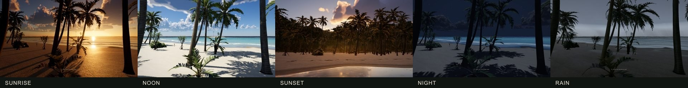
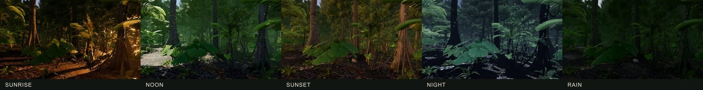
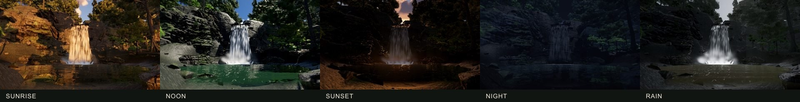
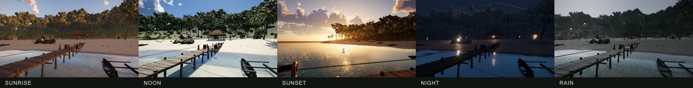
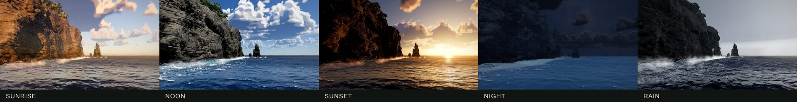
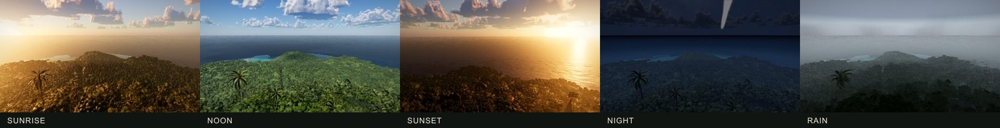

# Round 4 independent visual critique

## Capture scope and interpretation

Reviewed all 30 high-preset state captures, all six contact sheets, the note-open frame, and the first-Keeper frame. Individual frames are in [captures/](round-04/captures/); six full five-state strips appear in the reference boards below. Capture metadata in [report.json](round-04/captures/report.json) records view=shot, ANGLE / WebGPU, quality=high, renderScale=1, and a 7,325 ms ready time.

The JPEGs are 1920×1080 outputs, but the capture report identifies DISPLAY1 with an **emulated viewport**. Only the built-in panel was connected during the run; no physical second screen was used. Treat the frames as emulated output captures, not as proof of native full-screen 1920×1080 rendering on a second monitor.

Round 4 is not a same-camera comparison with Round 3. Round 3 used quality=low, renderScale=0.5, and view=follow; Round 4 used quality=high, renderScale=1, and view=shot. Round 4 exposes much finer leaf, rock, and water detail than the softened low-scale Round 3 strips. The changed camera poses also change composition, so sharper detail is a preset/resolution difference and the framing deltas cannot be attributed to environment edits alone. Remaining issues below are visible even at high preset: repeated silhouettes, hard surface seams, over/underexposure, and weak depth cues.

## Side-by-side reference boards

Local columns show the Round 4 high-preset contact strips. Real-photo columns are Unsplash photographs whose source pages identify them as free under the Unsplash License. The game columns use official PlayStation-hosted screenshots from Ghost of Tsushima and Far Cry 6 for comparison.

| Round 4 capture strip | Real tropical reference | Official AAA open-world screenshot |
|---|---|---|
| **Beach**  |  [Photo and license page](https://unsplash.com/photos/an-aerial-view-of-a-tropical-beach-and-lagoon-Kmf8MZkk9GQ) |  [Official screenshot gallery](https://www.playstation.com/en-us/games/ghost-of-tsushima/pc/) |
| **Jungle**  |  [Photo and license page](https://unsplash.com/photos/a-lush-green-forest-filled-with-lots-of-trees-GlNSjGRugTE) |  [Official screenshot gallery](https://www.playstation.com/en-us/games/ghost-of-tsushima/pc/) |
| **Waterfall**  |  [Photo and license page](https://unsplash.com/photos/a-lush-green-jungle-waterfall-cascades-into-a-serene-pool-UhMY9THZRpE) |  [Official Far Cry 6 gallery](https://www.playstation.com/de-de/games/far-cry-6/) |
| **Fishing village**  |  [Photo and license page](https://unsplash.com/photos/wooden-stilt-village-and-boat-on-tranquil-turquoise-waters-VbmZxWYAaE8) |  [Official Far Cry 6 gallery](https://www.playstation.com/de-de/games/far-cry-6/) |
| **Cliffs**  |  [Photo and license page](https://unsplash.com/photos/tropical-island-cliffs-with-clear-blue-ocean-water--BRmHGLuB0k) |  [Official screenshot gallery](https://www.playstation.com/en-us/games/ghost-of-tsushima/pc/) |
| **Lighthouse panorama**  |  [Photo and license page](https://unsplash.com/photos/white-lighthouse-on-tropical-island-with-boats-ndlt4ZBLFVQ) |  [Official screenshot gallery](https://www.playstation.com/en-us/games/ghost-of-tsushima/pc/) |

The real-photo comparisons expose the largest material differences: irregular nearshore foam and reef colors, water-depth gradients, and nonuniform vegetation edge lines. The AAA screenshots show more layered foreground-to-distance separation, fewer repeated crown silhouettes, and better preservation of local contrast in shaded areas. The Round 4 captures have more visible detail than the low/0.5 Round 3 sheet, but the larger output does not remove these scale and pattern gaps.

## Condition-by-condition evidence

Each linked state below was inspected at the reported high preset. Entries identify the most visible remaining gap for that specific state. Still frames do not establish animated water, leaf wind, rain motion, boat bob, character gait, or light sweep; those require the short headed playback check called out below.

### Beach

| State | Frame | Specific visible gap |
|---|---|---|
| Sunrise | [beach_sunrise.jpg](round-04/captures/beach_sunrise.jpg) | **Exposure/shadows:** the low sun and reflection bleach the right horizon while the foreground palms fall nearly black. **Water/surface:** shallow water resolves into long parallel bands with hard foam edges. **Scale/foliage:** several close trunks block the coast and repeat similar palm silhouettes; no atmospheric layer separates the far shore. |
| Noon | [beach_noon.jpg](round-04/captures/beach_noon.jpg) | **Lighting/shadows:** sand clips toward white and the palm shadows have hard, high-contrast edges. **Water/material:** cyan shallows stop at a dark, ruler-straight ocean band; foam is a narrow repeated strip. **Foliage/scale:** a huge foreground frond and vertical trunks hide much of the coastline, making the beach feel like a small planted cove. |
| Sunset | [beach_sunset.jpg](round-04/captures/beach_sunset.jpg) | **Exposure/scale:** the avatar is a tiny dark mark against a dense tree wall, with little readable beach activity. **Material/foliage:** wide sand uses regular fine ridges and the palms merge into a repeated canopy edge. **Atmosphere:** the large soft-edged cloud masses are stylized; there is no visible distance haze through the forest. |
| Night | [beach_night.jpg](round-04/captures/beach_night.jpg) | **Lighting:** trunks and sand lose most detail while a bright cyan sea strip stays saturated. **Water:** the shore foam and shallow-water line remain nearly horizontal and static-looking. **Scale/fog:** the small offshore islet has no intermediate haze or moonlit reflection to establish distance. |
| Rain | [beach_rain.jpg](round-04/captures/beach_rain.jpg) | **Exposure/atmosphere:** the sky becomes a uniform gray ceiling with little cloud depth. **Water/wetness:** parallel surf lines persist and the sand has no clear puddle breakup or wet sheen. **Foliage/shadows:** the palm mass is nearly black against the sky; the still cannot verify wind or rain animation. |

### Jungle

| State | Frame | Specific visible gap |
|---|---|---|
| Sunrise | [jungle_sunrise.jpg](round-04/captures/jungle_sunrise.jpg) | **Lighting/shadows:** warm light at right leaves the central understory very dark. **Foliage/material:** large fan fronds repeat radial shapes, while the leaf-litter floor reads as a high-frequency mottled carpet. **Scale/fog:** foreground leaves dominate and there is little atmospheric falloff through the trunks. |
| Noon | [jungle_noon.jpg](round-04/captures/jungle_noon.jpg) | **Exposure/shadows:** bright path and canopy sit against a very dark ground layer. **Foliage:** a single oversized fan leaf dominates the center and several fern forms repeat at near-identical height. **Material/atmosphere:** leaf and soil breakup is mostly surface pattern; the background has no strong mist layering to clarify depth. |
| Sunset | [jungle_sunset.jpg](round-04/captures/jungle_sunset.jpg) | **Lighting:** amber color reaches trunks, but the forest floor still has near-black patches and the sun itself is not visible. **Foliage/scale:** evenly spaced trunks and repeated fan-leaf silhouettes expose the placement pattern. **Atmosphere:** no visible moving shafts, drifting mist, or canopy motion can be established from the frame. |
| Night | [jungle_night.jpg](round-04/captures/jungle_night.jpg) | **Lighting/shadows:** thick trunks collapse into black cutouts while pale foreground leaves remain conspicuously bright. **Materials:** wet-looking ground is broken into sharp dark/light patches without a readable source reflection. **Scale/fog:** the dense canopy closes to a flat wall; no moonlit depth cues or distance haze separate layers. |
| Rain | [jungle_rain.jpg](round-04/captures/jungle_rain.jpg) | **Exposure:** rain makes the scene nearly black despite the 14:30 staging time. **Atmosphere/material:** many small circular ground marks read as white rings; they do not communicate scale or impact direction clearly. **Foliage:** large leaves retain broad uniform surfaces with little visible wet highlight, and stills cannot verify wind response. |

### Waterfall

| State | Frame | Specific visible gap |
|---|---|---|
| Sunrise | [waterfall_sunrise.jpg](round-04/captures/waterfall_sunrise.jpg) | **Exposure:** gold light makes the falls and pool highlights clip while the back wall goes dark. **Water/material:** the cascade reads as two bright continuous sheets with little separated spray; the pool is dark and opaque. **Rock/scale:** repeated horizontal seams on the broad ledges make the cliff feel assembled in layers. |
| Noon | [waterfall_noon.jpg](round-04/captures/waterfall_noon.jpg) | **Water:** the bright curtain has uniform vertical streaks and a broad white impact patch; pool foam uses repeated scribbled lines over flat green water. **Lighting/shadows:** hard canopy shadows split the basin. **Materials/scale:** tiled-looking fissure marks and slab-like rocks dominate the wall; no fine water haze separates fall from cliff. |
| Sunset | [waterfall_sunset.jpg](round-04/captures/waterfall_sunset.jpg) | **Exposure:** most rock and vegetation fall toward black while the falls remain a gray-white stripe. **Water:** the pool reflection is too dark to show depth or impact rings. **Atmosphere:** the light color changes but there is little visible mist glow or wet-rock response to connect the cascade to the basin. |
| Night | [waterfall_night.jpg](round-04/captures/waterfall_night.jpg) | **Lighting:** cliff and pool nearly disappear into blue-black, leaving the falls as the only strong shape. **Water/material:** the fall remains a narrow repetitive veil without a readable moonlight/specular gradient. **Scale/fog:** there is no visible spray cloud or layered mist around the plunge point. |
| Rain | [waterfall_rain.jpg](round-04/captures/waterfall_rain.jpg) | **Exposure:** a blank gray opening in the canopy dominates above a very dark basin. **Water/material:** the pool turns muddy olive with bright repeated surface strokes, while the falling sheet and base plume become overbright. **Atmosphere:** rainfall lines are present, but the still shows little runoff on the ledges or interaction between rain and pool. |

### Fishing village

| State | Frame | Specific visible gap |
|---|---|---|
| Sunrise | [village_sunrise.jpg](round-04/captures/village_sunrise.jpg) | **Scale/composition:** empty sand takes most of the middle distance and the huts sit as small box-like silhouettes. **Materials:** dock boards and pilings repeat at regular spacing; the near canoe is a dark, simple outline. **Water/light:** shallow water is pale and mirror-smooth with little shore foam; no fog separates forest from buildings. |
| Noon | [village_noon.jpg](round-04/captures/village_noon.jpg) | **Exposure/shadows:** the sand is nearly white and the pavilion shadow is a hard rectangle. **Scale/foliage:** huts are evenly spaced against a similarly repeated tree line, and rounded tree crowns make the hillside read as planted clumps. **Materials:** dock plank pattern and boat geometry remain clean and uniform. |
| Sunset | [village_sunset.jpg](round-04/captures/village_sunset.jpg) | **Lighting:** the sun clips at the shoreline and turns the far village into silhouettes. **Water:** specular points form a dense glitter band rather than varied wave/foam shapes. **Scale/activity:** broad foreground water and dock rails outweigh the small huts; there are no people, nets, or signs of fishing work. |
| Night | [village_night.jpg](round-04/captures/village_night.jpg) | **Exposure:** hut lamps are small bright dots against an otherwise crushed tree line; dock planks and boats lose shape. **Water/material:** blue reflections appear as a narrow repeated streak pattern. **Atmosphere:** one fine diagonal sky streak has no clear source/context; no smoke, movement, or weather depth is visible. |
| Rain | [village_rain.jpg](round-04/captures/village_rain.jpg) | **Atmosphere/light:** the gray sky and dark forest merge into a broad low-contrast band. **Water/material:** water shows a uniform sheen, while rain and impact splashes are subtle at dock distance. **Scale/activity:** huts, dock, and boat remain static and the open sand still reads empty. |

### Cliffs

| State | Frame | Specific visible gap |
|---|---|---|
| Sunrise | [cliffs_sunrise.jpg](round-04/captures/cliffs_sunrise.jpg) | **Lighting:** the left cliff is strongly orange and the water highlights blow out near shore. **Rock material/scale:** repeated rectangular fissure lines cover a very broad face, with few small cracks, plants, or debris to establish scale. **Water:** white surf appears as a continuous edge and the offshore horizon is razor-straight. |
| Noon | [cliffs_noon.jpg](round-04/captures/cliffs_noon.jpg) | **Lighting/shadows:** direct light creates hard black fissures and very bright foam. **Rock/material:** horizontal shelves and repeated grid-like fracture lines are visibly regular across the cliff. **Scale/atmosphere:** the sea stacks have a clear silhouette but the distant ocean has no haze layers and the nearest wall fills most of frame. |
| Sunset | [cliffs_sunset.jpg](round-04/captures/cliffs_sunset.jpg) | **Exposure:** most of the main cliff becomes a black mass beside a clipped low sun. **Water:** alternating orange and black bands do not show irregular nearshore depth. **Scale/material:** the sea stack is legible, but the cliff texture is lost exactly where the wall should provide scale; clouds retain rounded stylized edges. |
| Night | [cliffs_night.jpg](round-04/captures/cliffs_night.jpg) | **Lighting:** cliff strata are only faintly legible in blue-black shadow. **Water:** the ocean stays a broad uniform blue field with a hard horizon and little moonlit foam. **Atmosphere/scale:** sea stacks separate from the wall, but there is no fog gradient to establish their distance. |
| Rain | [cliffs_rain.jpg](round-04/captures/cliffs_rain.jpg) | **Exposure/material:** the wall remains near-black while white surf is very bright, so the wet rock itself is not readable. **Water:** the close swell has much stronger shape, but white foam repeats as broad lace-like ribbons. **Atmosphere:** fog erases the horizon into pale gray without a layered transition; stills cannot validate wave motion. |

### Lighthouse panorama

| State | Frame | Specific visible gap |
|---|---|---|
| Sunrise | [lighthouse_sunrise.jpg](round-04/captures/lighthouse_sunrise.jpg) | **Exposure/fog:** low sun washes out the left sea and distant coast. **Foliage/scale:** most of the island is a carpet of similarly rounded crowns; the central hill lacks visible terrain landmarks. **Water:** deep ocean reads as a brown-gray plane with little reef or wave scale. |
| Noon | [lighthouse_noon.jpg](round-04/captures/lighthouse_noon.jpg) | **Foliage/scale:** the view exposes a repeated quilt of rounded canopy clumps, with few distinctive mid-distance species or clearings. **Water:** reef color is a thin bright strip and deep ocean is nearly uniform navy. **Atmosphere/shadows:** coastline edges are crisp at distance, while vegetation below the camera has little aerial falloff. |
| Sunset | [lighthouse_sunset.jpg](round-04/captures/lighthouse_sunset.jpg) | **Exposure:** the sun blooms into a large clipped white disk and the island drops into a dark silhouette. **Water/material:** the sea becomes a bronze plane with small, repeated highlights. **Scale/fog:** no village, waterfall, or cliff landmark reads from the panorama; the crown carpet obscures the island's terrain. |
| Night | [lighthouse_night.jpg](round-04/captures/lighthouse_night.jpg) | **Lighting:** a broad opaque white beam wedge cuts down from the top of frame with no visible lamp/source and reads as a flat slab rather than a rotating volumetric beam. **Water:** the sea and horizon are almost uniform navy. **Scale/fog:** the island becomes a dark canopy silhouette and the reef is only a narrow cyan outline. |
| Rain | [lighthouse_rain.jpg](round-04/captures/lighthouse_rain.jpg) | **Atmosphere:** gray mist compresses sea, coast, and sky into adjacent flat bands and hides the horizon. **Foliage/scale:** canopy variation is lost at distance; the high viewpoint reveals rounded clumps but few distinct landmarks. **Light/water:** the sea is a gray field and no rain curtain or wave texture survives at this scale. |

## Note and Keeper evidence

- [Note open](round-04/captures/beach_note_open.jpg): the report records opened=true and closedWithEscape=true. The paper card is legible and says “The lamp went out at first light. Something answered from the water after the keeper was already home.” At world scale, the physical note marker remains a small dark post and is difficult to identify as paper.
- [First Keeper](round-04/captures/beach_first_keeper.jpg): metadata records phase=watching, presenceCount=1, seenTime=0.62 s, pressure=0.15, with the figure projected well right of the player (x=0.753 versus player x=-0.118). The capture shows a faint, semi-transparent human silhouette near the right edge. It reads as a ghosted traveler at this scale; its pose/profile does not yet separate it strongly from the player, and one still frame does not verify the reveal, gaze, or approach animation.

## Technical and motion-validation limits

- The 30-state report says ANGLE/WebGPU, high preset, renderScale=1, 1920×1080 output, emulated viewport, DISPLAY1, and load ready at 7.325 s. It contains console log/info entries and no recorded error or warning entry. No network waterfall is in the report.
- The capture harness records only 4–8 frame samples per staged state. Its high/emulated counters range from **14.3–23.3 reported FPS** and **83.3–132.6 ms p95 frame time**, with **214–684 draw calls** and **2.99–8.89 million triangles**. These short emulated capture counters are a separate data set from the M2 play run and are not a sustained device benchmark.
- Separate M2 production-default, low-preset measurements supplied for this review: **waterfall/rain 60 fps at 0.425 render scale; waterfall/night 59.4 fps at 0.4; lighthouse/rain and lighthouse/night 60 fps at 0.45. GPU query was unavailable.** These selected low-preset states do not establish high-preset 60 fps.
- **No short headed video/playback validation was provided.** Static captures cannot verify wave flow, waterfall turbulence, wind-driven foliage, rainfall, dock/boat movement, character gait and foot contacts, or the lighthouse sweep. A short visible playback route is needed before signing off on animation or atmosphere.

## Scorecard and next Builder priorities

Scores use the graphics skill's 0–3 anchors (1=basic styled, 2=premium stylized, 3=showcase). Scores are visual-review judgments from these captures, not a claim of objective image similarity.

| Category | Score | Concrete remaining gap |
|---|---:|---|
| Art direction | 1.5 | Island zones exist, but the repeated canopy, strata, and water patterns keep the overall scene from reading as a specific place. |
| Player / character | 1 | The traveler is a small generic silhouette in the frames; gait, foot contact, and state transitions have no motion evidence. |
| Threat / Keeper | 1 | First sighting is visible but faint, transparent, and too close in profile to the player silhouette. |
| Interactable | 1.5 | Note overlay is legible and opens/closes; the beach post itself is a dark, low-read prop. |
| World composition / scale | 1.5 | Lighthouse offers an island overview, but canopy carpet hides recognizable landmarks and terrain layers. |
| Materials | 1.5 | Rock surfaces show repeated grid seams, sand has regular ripples, the pool has drawn-looking strokes, and village wood lacks edge wear. |
| Lighting / shadows | 1 | Beach noon clips sand, cliff sunset/night crushes rock detail, and the lighthouse night beam is an opaque wedge. |
| Atmosphere / VFX | 1 | Rain and spray appear in stills but have weak surface interaction; motion and depth cues are unverified. |
| UI | 1.5 | The note card is readable; the physical clue and small interaction prompt need stronger world-scale hierarchy. |
| Performance evidence | 1 | Emulated high capture samples are below target; selected M2 low-preset cases hold near 60 only at 0.4–0.45 scale, with no GPU query. |

**Mean: 1.3 / 3.** The next pass should spend its visual budget in this order:

1. **Water and shore:** build irregular nearshore wave fronts, reef/sand depth colors, foam that breaks along actual shoreline contours, and a readable night reflection. For the waterfall, separate streams, pool depth, impact bubbles, spray, and wet ledges.
2. **Lighthouse night and exposure:** replace the opaque beam slab with a source-grounded volumetric sweep; preserve cliff and treetop detail at night; reduce clipped sun/sand in noon and sunset shots.
3. **Canopy and island scale:** vary crown shape, height, species, and spacing; add clearer ridge and clearing structure plus aerial perspective so the lighthouse panorama reads as terrain and landmarks instead of a rounded green carpet.
4. **Rock and settlement authorship:** break the repeated cliff seams, add small-scale fracture and moss placement, and give huts, dock planks, pilings, canoes, and fishing gear wear and use marks. Add one visible activity cue to establish village scale.
5. **Animation review:** record a short headed playback from the beach through jungle, waterfall, village, and lighthouse, including the Keeper's watching/reveal beat and a rain transition. Verify footsteps, locomotion contacts, water, foliage wind, boat motion, rain impacts, and beacon sweep while recording.
6. **Performance verification:** profile the same scenes at native target settings on the M2 and keep the low-preset render scale above the current 0.4–0.45 only if sustained frame time permits. Report CPU/GPU queries separately; this pass has no usable GPU query from the M2 run.

