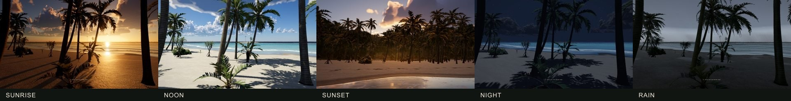
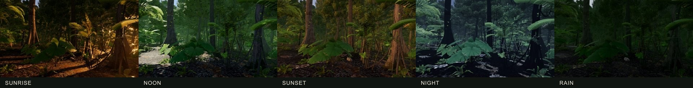
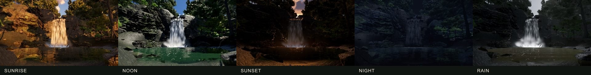
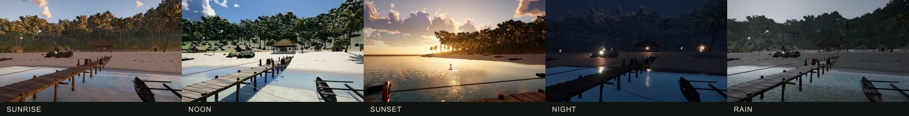
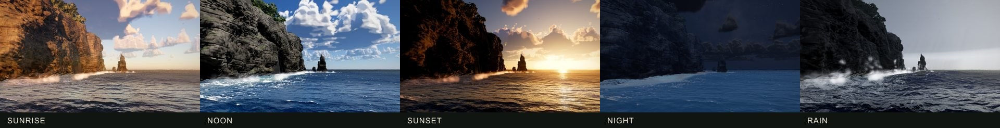
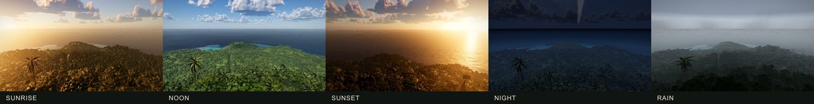

# Round 5 independent visual critique

## Capture scope and limits

Reviewed all 30 Round 5 high-preset state captures (six locations × sunrise, noon, sunset, night, and rain), the six five-state contact sheets, the open-note and first-Keeper captures, and both short H.264 clips. The capture report records the Builder commit as `f8a651d`, quality=high, renderScale=1, ANGLE/WebGPU, a 7,453 ms ready time, and 1920×1080 output. The viewport was **emulated on DISPLAY1**; the host had only one physical display, so this is not a second-screen capture or native full-screen proof.

These are visual comparisons, not matched-camera image tests. The photo and AAA references below are useful for concrete material, depth, scale, and lighting gaps, but their viewpoints and weather are not identical to the game shots. The real-photo source pages and Unsplash license pages are linked; the prior Round 4 audit identified these images as free under the Unsplash License. The game screenshots are hosted in official PlayStation galleries.

## Side-by-side reference boards

Each Round 5 strip contains the five staged conditions. The linked files open larger versions. These boards provide the direct visual comparison; the state-by-state findings below call out the specific remaining differences in each frame.

| Round 5 strip | Real tropical island photograph | Official AAA open-world screenshot |
|---|---|---|
| **Beach**  |  [Photo and license page](https://unsplash.com/photos/an-aerial-view-of-a-tropical-beach-and-lagoon-Kmf8MZkk9GQ) |  [Official screenshot gallery](https://www.playstation.com/en-us/games/ghost-of-tsushima/pc/) |
| **Jungle**  |  [Photo and license page](https://unsplash.com/photos/a-lush-green-forest-filled-with-lots-of-trees-GlNSjGRugTE) |  [Official screenshot gallery](https://www.playstation.com/en-us/games/ghost-of-tsushima/pc/) |
| **Waterfall**  |  [Photo and license page](https://unsplash.com/photos/a-lush-green-jungle-waterfall-cascades-into-a-serene-pool-UhMY9THZRpE) |  [Official Far Cry 6 gallery](https://www.playstation.com/de-de/games/far-cry-6/) |
| **Fishing village**  |  [Photo and license page](https://unsplash.com/photos/wooden-stilt-village-and-boat-on-tranquil-turquoise-waters-VbmZxWYAaE8) |  [Official Far Cry 6 gallery](https://www.playstation.com/de-de/games/far-cry-6/) |
| **Cliffs**  |  [Photo and license page](https://unsplash.com/photos/tropical-island-cliffs-with-clear-blue-ocean-water--BRmHGLuB0k) |  [Official screenshot gallery](https://www.playstation.com/en-us/games/ghost-of-tsushima/pc/) |
| **Lighthouse panorama**  |  [Photo and license page](https://unsplash.com/photos/white-lighthouse-on-tropical-island-with-boats-ndlt4ZBLFVQ) |  [Official screenshot gallery](https://www.playstation.com/en-us/games/ghost-of-tsushima/pc/) |

Round 5 has visible gains: the beach sunrise is a strong composition, the cliff wall keeps more readable relief at night, and the aerial canopy has slightly less uniform clump spacing. The photo and AAA comparisons still show cleaner nearshore depth and foam breakup, more naturally layered foliage, more varied small-scale rock detail, and stronger landmark separation than the game captures. The close frames also show repeated canopy and rock patterns that are less obvious in the small contact strips.

## Condition-by-condition evidence

Every frame below is a 1920×1080 emulated capture. Notes focus on visible gaps; a still frame does not prove how the feature moves.

### Beach

| State | Frame | Concrete viewer-facing difference |
|---|---|---|
| Sunrise | [beach_sunrise.jpg](round-05/captures/beach_sunrise.jpg) | **Lighting/water:** the sunrise and reflection give the scene a strong silhouette, but the bright path burns almost white and the foreground palms drop to black. The shallow surf breaks into long, almost parallel lines with hard foam edges. **Scale:** the central trunks and near fronds obscure a large share of the coast. |
| Noon | [beach_noon.jpg](round-05/captures/beach_noon.jpg) | **Material/exposure:** the sand still reads nearly white and carries fine, regular ripple marks. The turquoise shallows end at a dark, ruler-straight horizon band. **Foliage/scale:** oversized foreground fan leaves and two thick trunks crowd the view and make the beach feel like a small cove. |
| Sunset | [beach_sunset.jpg](round-05/captures/beach_sunset.jpg) | **Lighting/foliage:** the gold edge light and palm silhouettes read well, but much of the grove is a single dark mass with little leaf-level separation. **Material:** sand ridges repeat in tight rows; the sea reflection is a smooth bright strip rather than irregular bands of surf and wet sand. |
| Night | [beach_night.jpg](round-05/captures/beach_night.jpg) | **Lighting:** the foreground trunks and sand lose most detail while the horizon water remains a conspicuous saturated blue. **Water/scale:** shore foam and shallow-water transitions still form nearly horizontal bands, with little moonlit reflection or aerial haze to set the offshore distance. |
| Rain | [beach_rain.jpg](round-05/captures/beach_rain.jpg) | **Atmosphere/material:** a flat gray sky and muted sea make the weather state legible, but the nearshore remains a set of straight parallel bands. Wet sand has little visible puddle breakup or varied sheen; palms fall into a dark silhouette against the sky. |

### Jungle

| State | Frame | Concrete viewer-facing difference |
|---|---|---|
| Sunrise | [jungle_sunrise.jpg](round-05/captures/jungle_sunrise.jpg) | **Foliage/scale:** radial fan leaves dominate the foreground and several similar leaf shapes repeat at similar height. **Lighting/depth:** warm light reaches parts of the canopy while the understory stays very dark; trunks and the background lose layered haze separation. |
| Noon | [jungle_noon.jpg](round-05/captures/jungle_noon.jpg) | **Foliage:** one very large fan leaf at center-left blocks the view into the forest, and broad fern/palm forms repeat across the midground. **Materials/shadows:** the ground reads as dark mottled texture, not individually layered roots, leaf litter, and soil, and the black understory is a sharp contrast against the bright leaves. |
| Sunset | [jungle_sunset.jpg](round-05/captures/jungle_sunset.jpg) | **Lighting/scale:** amber light colors the upper trunks, but the lower forest still collapses to dark patches. Evenly spaced vertical trunks and repeated umbrella crowns give away the placement pattern; no distant mist layer separates the back of the grove. |
| Night | [jungle_night.jpg](round-05/captures/jungle_night.jpg) | **Lighting/material:** trunks become near-black cutouts while some foreground leaves stay bright green. The wet-looking floor is broken into sharp, pale reflective patches without a clear local light source. **Scale:** the repeated leaf silhouettes close the far grove into a wall. |
| Rain | [jungle_rain.jpg](round-05/captures/jungle_rain.jpg) | **Exposure/VFX:** the forest is very dark despite the gray daylight opening above it; bright rain and circular ground rings are visible but read as isolated marks rather than scaled splashes. Broad leaves retain large uniform surfaces with little obvious wet highlight or wind response in the still. |

### Waterfall

| State | Frame | Concrete viewer-facing difference |
|---|---|---|
| Sunrise | [waterfall_sunrise.jpg](round-05/captures/waterfall_sunrise.jpg) | **Water/light:** the fall remains a bright, broad veil with an over-bright impact patch, while the back wall and pool fall dark. The pool reads as opaque green-brown water with a small number of graphic surface streaks. **Rock:** long, regular ledge seams remain visible across the wall. |
| Noon | [waterfall_noon.jpg](round-05/captures/waterfall_noon.jpg) | **Water:** the drop is better split into strands than an unbroken pair of sheets, but its vertical streaks are still repetitive and its base plume is blown white. The pool has opaque olive color and decorative white loops. **Rock/light:** repeated horizontal seams and a hard canopy shadow split the basin. |
| Sunset | [waterfall_sunset.jpg](round-05/captures/waterfall_sunset.jpg) | **Lighting/atmosphere:** most of the surrounding wall and vegetation sink toward black while the fall remains a pale stripe. The pool is too dark to show a convincing reflection or depth change, and there is little visible glow from spray or wet rock. |
| Night | [waterfall_night.jpg](round-05/captures/waterfall_night.jpg) | **Lighting/water:** the falls become the lone clear shape over a blue-black wall and pool. The water is a narrow, repetitive veil without a readable moonlit specular gradient or spray cloud at the plunge point. **Materials:** the repeated wall seams remain legible even in the night light. |
| Rain | [waterfall_rain.jpg](round-05/captures/waterfall_rain.jpg) | **Water/exposure:** the white curtain and base plume flare against the gray opening, while the pool turns muddy olive with repeated white strokes. **Atmosphere/material:** rain is visible, but the wall does not show much runoff and the basin has little interaction detail around the impact. |

### Fishing village

| State | Frame | Concrete viewer-facing difference |
|---|---|---|
| Sunrise | [village_sunrise.jpg](round-05/captures/village_sunrise.jpg) | **Scale/activity:** much of the frame is empty beach or open water; the huts and dock activity occupy a small, simple cluster. **Materials:** plank spacing and pilings are very regular, and the boat remains a clean silhouette without visible wear, netting, or fishing clutter. |
| Noon | [village_noon.jpg](round-05/captures/village_noon.jpg) | **Materials/scale:** the sand is pale and the huts are clean, boxy gable forms with broad unmarked roof surfaces. Dock planks and pilings repeat evenly. **Foliage/activity:** the hillside crowns repeat as rounded clumps, and there are no people or working cues to establish the settlement's scale. |
| Sunset | [village_sunset.jpg](round-05/captures/village_sunset.jpg) | **Lighting/water:** the reflection creates a bright central axis and a warm overall read, but the sea surface stays very smooth with regular highlights. **Scale/activity:** huts sit far across the empty shore; no visible fishing gear or human activity breaks the silhouettes. The large rail across the foreground reads as a simple straight bar. |
| Night | [village_night.jpg](round-05/captures/village_night.jpg) | **Lighting:** lamps are small, intense points against a very dark treeline and the jetty planks lose much of their shape. **Materials/water:** saturated blue water has sparse bright reflection marks, and the canoe and dock remain simple, hard-edged forms. |
| Rain | [village_rain.jpg](round-05/captures/village_rain.jpg) | **Atmosphere/scale:** gray sky, sea, and treeline compress into broad low-contrast bands; the little buildings and dock sit against an empty beach. Rain and water impact are hard to read at this distance, and wet wood has little visible sheen variation. |

### Cliffs

| State | Frame | Concrete viewer-facing difference |
|---|---|---|
| Sunrise | [cliffs_sunrise.jpg](round-05/captures/cliffs_sunrise.jpg) | **Lighting/material:** warm side light catches the wall, but highlights near the water are strong and the dark face is built from regular shelf-like planes. **Water/scale:** foam follows the cliff as a continuous edge and the distant horizon is very crisp. |
| Noon | [cliffs_noon.jpg](round-05/captures/cliffs_noon.jpg) | **Rock:** repeated horizontal seams and grid-like fractures cross large sections of the wall, with few small cracks or plants to break the pattern. **Water/atmosphere:** the stacks silhouette clearly, but the ocean and hard horizon have little distance haze or nearshore depth variation. |
| Sunset | [cliffs_sunset.jpg](round-05/captures/cliffs_sunset.jpg) | **Lighting/rock:** the warm sun and reflected surface make a strong shot, yet the main cliff reads as a near-black geometric mass with prominent slab seams. **Water:** wave crests have more relief than the beach, but foam still forms bright, repeated streaks along the base. |
| Night | [cliffs_night.jpg](round-05/captures/cliffs_night.jpg) | **Lighting:** the cliff relief is more readable than in Round 4, a clear improvement, but the exposed joints still make horizontal rows. **Water/scale:** the sea is nearly uniform blue, the horizon remains a straight hard line, and the stacks lack haze that would place them farther away. |
| Rain | [cliffs_rain.jpg](round-05/captures/cliffs_rain.jpg) | **Water/VFX:** large swells and shoreline spray are visible, but bright white foam blobs/ribbons repeat along the wall. **Rock/atmosphere:** the wet cliff remains close to black with little readable wet sheen; the gray sky erases distance in one broad band rather than a layered fog transition. |

### Lighthouse panorama

| State | Frame | Concrete viewer-facing difference |
|---|---|---|
| Sunrise | [lighthouse_sunrise.jpg](round-05/captures/lighthouse_sunrise.jpg) | **Exposure/scale:** low sun washes the sea and distant coast. From above, the canopy is still a repeated carpet of rounded crowns; the shoreline has few recognizable landmarks that identify the beach, village, or falls. |
| Noon | [lighthouse_noon.jpg](round-05/captures/lighthouse_noon.jpg) | **Scale/vegetation:** crown spacing is less uniform than in earlier rounds, but the view still reads as a quilt of similar rounded clumps with few distinct clearings or species. **Water/depth:** reef color is a thin strip against broad, nearly uniform deep water; distant ridges have little aerial falloff. |
| Sunset | [lighthouse_sunset.jpg](round-05/captures/lighthouse_sunset.jpg) | **Exposure/scale:** the bright sun clips over the water and the island drops into a dark silhouette. The high view exposes the canopy's round clump pattern; village and waterfall landmarks do not read clearly enough to give the panorama a specific layout. |
| Night | [lighthouse_night.jpg](round-05/captures/lighthouse_night.jpg) | **Light/animation:** the still shows a narrow gray wedge entering from above, without the beacon source in frame; it reads as a translucent surface rather than light scattering through air. **Water/scale:** ocean and horizon are close to uniform blue, and the island is a weakly differentiated canopy silhouette. |
| Rain | [lighthouse_rain.jpg](round-05/captures/lighthouse_rain.jpg) | **Atmosphere:** the gray storm haze flattens sky, water, and distant shoreline into adjacent bands and removes horizon clarity. **Scale/foliage:** the high camera still reveals rounded crown repetition, but terrain landmarks are lost through the mist. |

## Note, Keeper, and clip playback

- [Open note](round-05/captures/beach_note_open.jpg) and [first Keeper](round-05/captures/beach_first_keeper.jpg) are included. The note opens in the capture, but its small dark beach marker is difficult to distinguish before interaction. The Keeper remains a faint, translucent human silhouette near the edge of the frame; these stills cannot establish gaze, approach, or body animation.
- [Beach waves clip](../clips/round-05/waves_beach.mp4) is about four seconds. Comparing the beginning and end shows limited movement in the surface and waterline/foam bands. The camera stays fixed and no player gait or foot contact is shown; the visible change does not establish a strong traveling shore break.
- [Lighthouse beacon clip](../clips/round-05/lighthouse_beacon.mp4) is about five seconds. A narrow pale beam is visible entering from the upper-right at the start and is outside the frame in later samples. This confirms the light direction changes enough to leave the shot, but does not show a complete rotation or a convincing source-grounded volumetric sweep. The fixed panorama also keeps the hard horizon and rounded canopy pattern in view.
- Neither clip demonstrates rain transition, foliage wind, waterfall motion, village activity, boat bobbing, swimming, or character locomotion. Do not infer those animations from these captures.

## Capture and performance caveats

- The report contains 30 staged location/condition frames plus the note and Keeper captures. Readiness was 7,453 ms. Capture sampling in the report was only 5–7 frames per state; reported high-preset sample rates range from **13.6–22.5 fps**, p95 frame times from **83.4–133.4 ms**, with **214–684 draw calls** and **2.99–8.85 million triangles**. These emulated, short capture samples are not a sustained M2 gameplay benchmark, but they do not support a high-preset 60 fps claim.
- Separate M2 production-default measurements cover only four selected **low-preset** states: waterfall/rain 60.0 fps at 0.425 scale; lighthouse/rain 60.0 at 0.45; waterfall/night 59.6 at 0.40; lighthouse/night 60.0 at 0.45. Their capped p99 frame times are 17.7 ms, slightly above a 16.7 ms 60 fps budget. GPU timing is unavailable (0.00 in the report). These samples say nothing conclusive about sustained high-preset performance or the other four world areas.
- The captures are emulated 1920×1080 viewport output on one physical display, not second-screen evidence. The clips are short and camera-scripted, not a continuous playthrough. No browser-native control, traversal, or streaming test was part of this independent visual review.

## Scorecard and next Builder priorities

Scores use the same 0–3 review scale as Round 4: 0=missing, 1=basic, 2=strong stylized, 3=showcase. They summarize visible evidence, not objective pixel similarity.

| Category | Score | Concrete remaining gap |
|---|---:|---|
| Art direction | 1.5 | The island zones and sunset compositions are readable, but recurring canopy, cliff, and shoreline patterns keep the world from feeling authored at AAA reference detail. |
| Player / character | 1.0 | The staged views offer little character readability and the clips do not show gait, foot contact, swimming, or traversal. |
| Threat / Keeper | 1.0 | The first silhouette is present but faint and translucent, and no clip establishes a distinct reveal or motion. |
| Interactable / note | 1.5 | The note overlay is readable and the state is captured open, but the beach marker is small and low-contrast at world scale. |
| World composition / scale | 1.5 | Beach, village, cliffs, and falls exist, but the lighthouse panorama lacks clear landmarks and layered depth across the island. |
| Materials | 1.5 | Sand ripples repeat, waterfall pool strokes look graphic, cliff seams form rows, and village wood is clean and evenly spaced. |
| Lighting / shadows | 1.5 | Night cliff relief improved, while noon sand and sunrise reflections still clip, jungle shadow detail collapses, and the beacon reads as a wedge. |
| Atmosphere / VFX | 1.5 | Waves and beacon direction have some evidenced motion; surf foam remains linear, the waterfall and rain interaction need depth, and other motions are unverified. |
| UI | 1.5 | The note prompt/card is legible, but the physical clue needs clearer contrast and world-scale prominence. |
| Performance evidence | 1.0 | Selected low-preset M2 runs approach 60 only at 0.40–0.45 scale; high-preset capture samples are far below target and are too short/emulated to represent sustained play. |

**Mean: 1.35 / 3.** Round 5 improves some detail and adds limited motion evidence, but the largest viewer-facing differences remain. Another Builder pass is warranted.

Ranked next priorities:

1. **Fix water and waterfall first.** Break up straight surf bands with irregular shore-following foam, visible shallow reef-to-deep gradients, and stronger traveling wave motion. Give the pool depth, variable foam, impact spray, and wet ledges; avoid the bright uniform curtain and hand-drawn white strokes.
2. **Make the beacon read as a lamp in air.** Show a clear lighthouse source or explain the off-screen beam origin, use a narrow scattering cone with distance falloff and subtle sea response, and verify a full sweep from a stable camera. The current clip only shows the beam leave the upper-right of frame.
3. **Re-author high-level vegetation and island landmarks.** Add varied canopy species, height, clump scale, canopy gaps, ridge shapes, and atmospheric perspective. From the lighthouse, make the beach, fishing village, waterfall, and cliffs individually recognizable.
4. **Break the cliff and village repetition.** Add irregular fractures, debris, moss, and local wet highlights to the rock wall. Give huts, planks, pilings, boats, and fishing props uneven wear, material variation, and one or two visible signs of use or people.
5. **Tune exposure and night/rain readability.** Preserve sand texture at noon and highlight detail at sunrise; bring back limited trunk/ground detail in the jungle at night and rain; use layered storm haze rather than broad gray bands.
6. **Record an actual traversal and threat beat.** Capture player walk/sprint/jump, swimming, steps across surfaces, the Keeper reveal, rain, waterfall, and dock/boat motion so the user-visible game feel can be judged rather than inferred from stills.
7. **Profile the target configuration on the M2.** Measure sustained high and low preset frame times in a real play route, keep frame pacing within the 16.7 ms budget for 60 fps, and report the usable CPU/GPU timing separately.

**Decision:** meaningful visual differences still remain in water, foliage, material scale, atmosphere, and animation. Do not stop the gauntlet at Round 5; proceed to Round 6.
