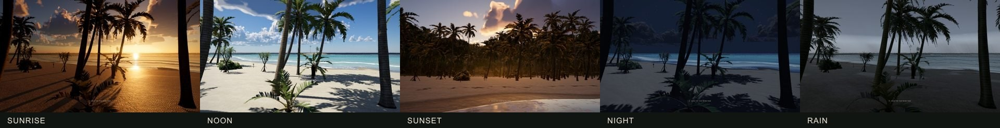
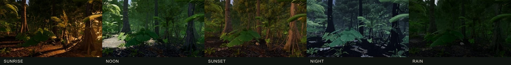
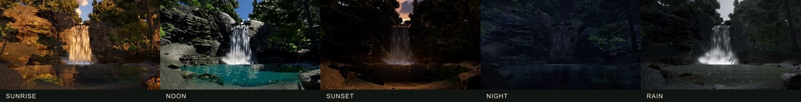
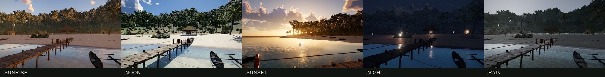
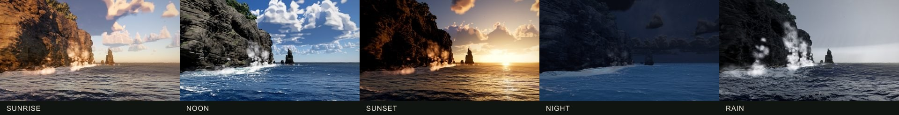
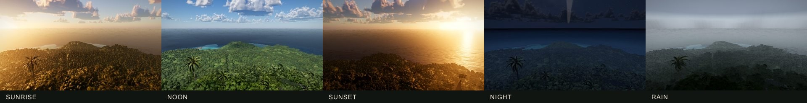

# Round 6 independent visual critique

## Scope and limits

Reviewed all 30 Round 6 high-preset captures (six places × sunrise, noon, sunset, night, rain), the six contact boards, note-open and first-Keeper frames, both eight-second H.264 clips, and the low-preset production pacing report. The capture report records ANGLE/WebGPU, 1920×1080, 8,145 ms readiness, and an **emulated** viewport on the built-in display. There was no physical second screen, so these are not second-screen or native-fullscreen captures.

The six Unsplash photo pages still load and identify the linked subjects; each displays the Unsplash License. The official [Ghost of Tsushima PC gallery](https://www.playstation.com/en-us/games/ghost-of-tsushima/pc/) and [Far Cry 6 gallery](https://www.playstation.com/de-de/games/far-cry-6/) also load. These are useful visual anchors, not matched camera or weather comparisons.

## Side-by-side boards

| Game capture strip | Tropical island photo | Official AAA open-world screenshot |
|---|---|---|
| **Beach**  |  [Photo page](https://unsplash.com/photos/an-aerial-view-of-a-tropical-beach-and-lagoon-Kmf8MZkk9GQ) |  [Official gallery](https://www.playstation.com/en-us/games/ghost-of-tsushima/pc/) |
| **Jungle**  |  [Photo page](https://unsplash.com/photos/a-lush-green-forest-filled-with-lots-of-trees-GlNSjGRugTE) |  [Official gallery](https://www.playstation.com/en-us/games/ghost-of-tsushima/pc/) |
| **Waterfall**  |  [Photo page](https://unsplash.com/photos/a-lush-green-jungle-waterfall-cascades-into-a-serene-pool-UhMY9THZRpE) |  [Official gallery](https://www.playstation.com/de-de/games/far-cry-6/) |
| **Fishing village**  |  [Photo page](https://unsplash.com/photos/wooden-stilt-village-and-boat-on-tranquil-turquoise-waters-VbmZxWYAaE8) |  [Official gallery](https://www.playstation.com/de-de/games/far-cry-6/) |
| **Cliffs**  |  [Photo page](https://unsplash.com/photos/tropical-island-cliffs-with-clear-blue-ocean-water--BRmHGLuB0k) |  [Official gallery](https://www.playstation.com/en-us/games/ghost-of-tsushima/pc/) |
| **Lighthouse panorama**  |  [Photo page](https://unsplash.com/photos/white-lighthouse-on-tropical-island-with-boats-ndlt4ZBLFVQ) |  [Official gallery](https://www.playstation.com/en-us/games/ghost-of-tsushima/pc/) |

The main measured gain from Round 6 is the pool’s clearer blue-green color and visible shallow shelf. Alongshore wave variation is only a subtle change in these compositions; the water still reads as long parallel ribbons. The direct photos show irregular coastlines, more depth transitions, and object-scale variation; the AAA references show stronger landmark separation, atmospheric layering, and more detailed material breakup.

## Condition-by-condition findings

Every image is a 1920×1080 emulated capture. Each statement names a visible difference, not an aesthetic verdict.

| Place | State | Concrete viewer-facing difference |
|---|---|---|
| Beach | Sunrise | The warm horizon and reflection make a readable opening, but the sun path clips nearly white, foreground palm trunks and fronds collapse to black, and breakers remain thin parallel lines with hard edges. |
| Beach | Noon | Sand is nearly white and evenly rippled; turquoise shallows stop at a ruler-straight dark offshore band, while white foam makes long clean arcs instead of broken swash. |
| Beach | Sunset | Gold reflection and palm silhouettes are strong, but the grove reads as one dark block; wet sand and sea reflection are regular horizontal bands with little puddle breakup. |
| Beach | Night | Trunks and ground lose detail, the sea stays a uniform saturated blue, and there is little moonlit shimmer or atmospheric distance at the straight horizon. |
| Beach | Rain | Grey sky and sea flatten into bands; wet sand has no clear patchy puddles, and the shore foam stays parallel rather than turning irregular with the beach. |
| Jungle | Sunrise | Sunlight catches the canopy, but broad fan leaves crowd the path, several similar umbrella crowns repeat, and the dark understory has little layered haze. |
| Jungle | Noon | Foreground leaves are oversized and obstruct the view; bright crowns sit above a very dark floor, with small leaf litter and trunks reading as mottled texture rather than layered soil and roots. |
| Jungle | Sunset | Amber light reaches upper leaves while lower trunks merge into dark masses; repeated crowns and missing background mist flatten the depth toward the far grove. |
| Jungle | Night | Trunks become near-black cutouts against patches of bright green foliage; the ground has sharp reflective flecks without a visible local light source. |
| Jungle | Rain | Rain is legible in the atmosphere, but the understory stays dark and broad leaves lack wet highlights or runoff; the distant canopy remains a dense, repeated wall. |
| Waterfall | Sunrise | The pool is less olive than Round 5, but the bright curtain and white impact patch still dominate; the gorge falls into shadow and its horizontal rock seams remain conspicuous. |
| Waterfall | Noon | Blue-green shallows reveal rocks at the edge, while the middle remains opaque and flat; long white curls look painted, the waterfall separates into repetitive vertical ribbons, and the impact is blown white. |
| Waterfall | Sunset | The fall stays pale against a dark gorge, with little visible mist glow or wet-rock response; the water surface is darker than the bright streaks suggest. |
| Waterfall | Night | A white vertical fall and base patch float against a nearly black wall and pool; there is no readable moon reflection or source-grounded light on the spray. |
| Waterfall | Rain | Rain is visible, but the curtain and impact remain bright and broad; the pool turns muted olive-grey and retains the same decorative foam loops. |
| Village | Sunrise | The dock, boats, and huts are small across a wide empty shoreline; plank/piling spacing stays regular and the roofs lack wear or fishing clutter. |
| Village | Noon | A bright empty beach dominates the foreground; huts are clean boxy forms, dock boards repeat evenly, and the settlement has no people or visible working activity. |
| Village | Sunset | A bright central reflection draws the eye away from the village; the distant huts and empty beach remain small, with straight rails and evenly spaced pier boards. |
| Village | Night | Tiny lamps are the main village cues; the dock and boats lose detail in shadow, while the water becomes nearly black-blue with a few isolated highlights. |
| Village | Rain | Grey sky, treeline, and sea compress into a low-contrast band; rain and wet-wood sheen are difficult to read at this scale, and the beach remains empty. |
| Cliffs | Sunrise | Warm light catches the rock face, but horizontal strata and slab-like planes repeat; surf clings to the cliff as a bright continuous edge and the horizon stays crisp. |
| Cliffs | Noon | Grid-like fractures and horizontal seams cross the large cliff faces; the stacks lack distance haze, and the sea/reef transition is broad and uniform. |
| Cliffs | Sunset | Warm water reflection improves separation, but the cliff becomes a near-black geometric mass; the spray bursts read as round particle puffs rather than fine coastal mist. |
| Cliffs | Night | Rock relief mostly disappears into blue-black shadow; sea and sky meet in a hard line, with little moonlit surf or haze to place the stacks offshore. |
| Cliffs | Rain | White splash bursts stand out against a dark wet wall, but the rain does not create visible runoff or varied wet highlights; sea and distant sky flatten together. |
| Lighthouse | Sunrise | The high view shows a dense tree carpet, but beach, village, waterfall, and cliffs are not recognizable as separate landmarks; the near sun clips and the far coast has little haze. |
| Lighthouse | Noon | Island ridges and reefs are visible, but rounded canopy clumps repeat at a similar scale and the village/falls are not distinct from the forest; the ocean horizon is hard. |
| Lighthouse | Sunset | Bright sun clips over the sea and the island becomes a dark silhouette; repeated crowns obscure landform variation and no signature village/fall shapes identify the island. |
| Lighthouse | Night | A broad translucent triangular beam enters from the top with its source outside the frame; it still reads like a wedge on a surface, while the island below is too dark to distinguish districts. |
| Lighthouse | Rain | Broad grey haze removes horizon and landmark separation rather than building layered distance; the canopy forms a dark rounded quilt and the beacon is not visibly tied to a lamp. |

## Note, Keeper, motion, and performance

- The note card is legible at the bottom-center, but the physical marker is a small dark rectangle on a wide beach and is easy to miss before interaction. The first-Keeper image places a translucent human shape at the far-right edge; it is visible, but too faint and short in screen space to read as an immediate threat without already knowing where to look.
- [Eight-second beach clip](../clips/round-06/waves_beach.mp4): the reflection and cloud edges change, but the shoreline advances only slightly and the main foam bands remain nearly fixed/parallel. The fixed camera and absence of a player make this weak evidence of a traveling breaker.
- [Eight-second pool clip](../clips/round-06/swim_pool.mp4): the player transitions from standing at the bank to a swimming pose and moves into the basin. The swim state is visible; the water surface remains a nearly flat turquoise plane with persistent white curls, and the fall’s impact remains blown out. No clip tests the full beacon sweep, Keeper approach, rain transition, village activity, or feet/ground contacts.
- Production low-preset auto pacing: waterfall/night 59.9 fps at 0.425 scale, waterfall/rain 59.1 at 0.400, and lighthouse night/rain 60 at 0.450. Frame p95 is 17.5–17.7 ms; waterfall/rain p99 is 33.3 ms. GPU timestamps are unavailable. This is four selected states, not a sustained island traversal. High-preset still-capture sampling is 13.6–24.7 fps and is not a gameplay benchmark. The 1920×1080 viewport is emulated on the built-in display; no second-screen performance test occurred.

## Scorecard

Scale: 0 missing, 1 basic, 2 strong stylized, 3 showcase. Scores reflect this evidence and are not pixel-similarity measurements.

| Category | Score | Concrete gap |
|---|---:|---|
| Art direction | 1.5 | Zones read, but foliage, cliff, and water patterns remain procedural at normal viewing distance. |
| Player / character | 1.5 | Swimming is visible in the clip; no convincing gait, foot contact, or broader traversal sequence is evidenced. |
| Threat / Keeper | 1.0 | The silhouette is present but faint and placed at the edge; the review has no approach or gaze animation clip. |
| Interactable / note | 1.5 | The note card reads, but the world marker is small and low contrast. |
| World composition / scale | 1.5 | The lighthouse panorama does not separate the village, falls, beach, and cliffs as recognizable landmarks. |
| Materials | 1.5 | Pool color improved; sand is overbright, cliff layers repeat, village wood is clean, and pool foam looks drawn. |
| Lighting / shadows | 1.5 | Sunrise/noon highlights clip, jungle interiors go dark, and the lighthouse shaft lacks an in-frame source. |
| Atmosphere / VFX | 1.5 | Water and spray move, but coast travel is subtle, cliff splash puffs look particle-like, and fog is mostly a broad grey veil. |
| UI | 1.5 | Note typography is legible; the in-world clue remains easy to overlook. |
| Performance evidence | 1.5 | Low quality approaches 60 at 0.40–0.45 scale with one 33.3 ms p99; high preset and full-route performance remain unproven. |

**Mean: 1.45 / 3.** The pool color is a real improvement over Round 5. Meaningful differences remain in water motion/foam, waterfall behavior, and readable island scale; continue the gauntlet.

## Ranked next Builder priorities

1. **Rebuild the water read.** The beach still has parallel, hard-edged shore bands; the pool has a flat middle and graphic white curls. Use irregular shore-following foam and a clearer shallow-to-deep bed transition; make the pool streaks smaller, sparser, and tied to the waterfall impact/outflow.
2. **Give the waterfall weight and source lighting.** Break the repeated vertical ribbons, reduce the overexposed impact patch, add finer near-surface spray and wet ledges, and make the beacon visibly originate in the lantern room before evaluating its full sweep.
3. **Make the island legible at distance and the threat readable.** Add distinctive clearings/ridges and atmospheric separation so the high view identifies the village, falls, and cliffs; increase Keeper silhouette contrast and record its approach.

**Decision:** Round 6 improves the pool color, but the remaining water, landmark, Keeper, and motion differences still matter to a viewer. Proceed to Round 7.
